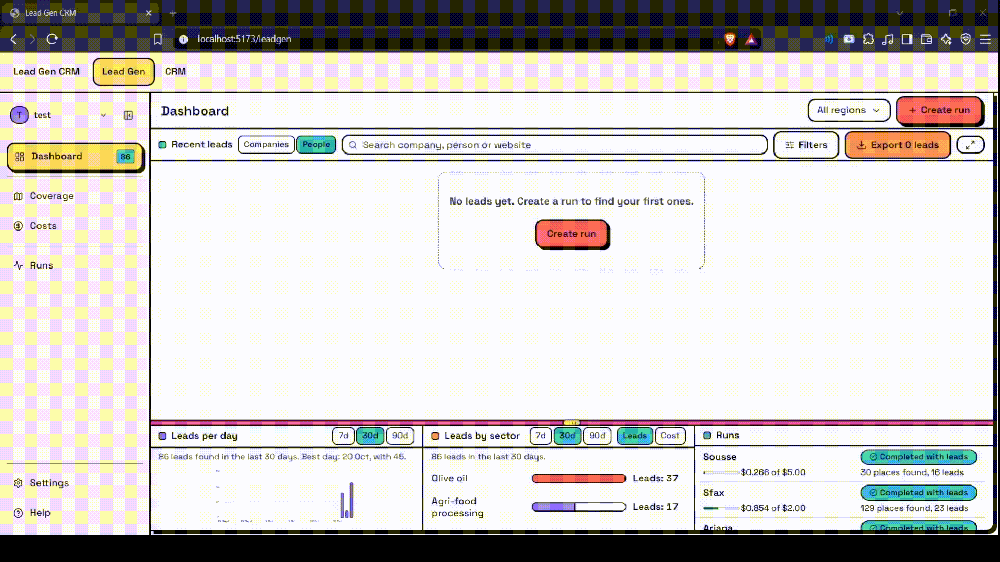
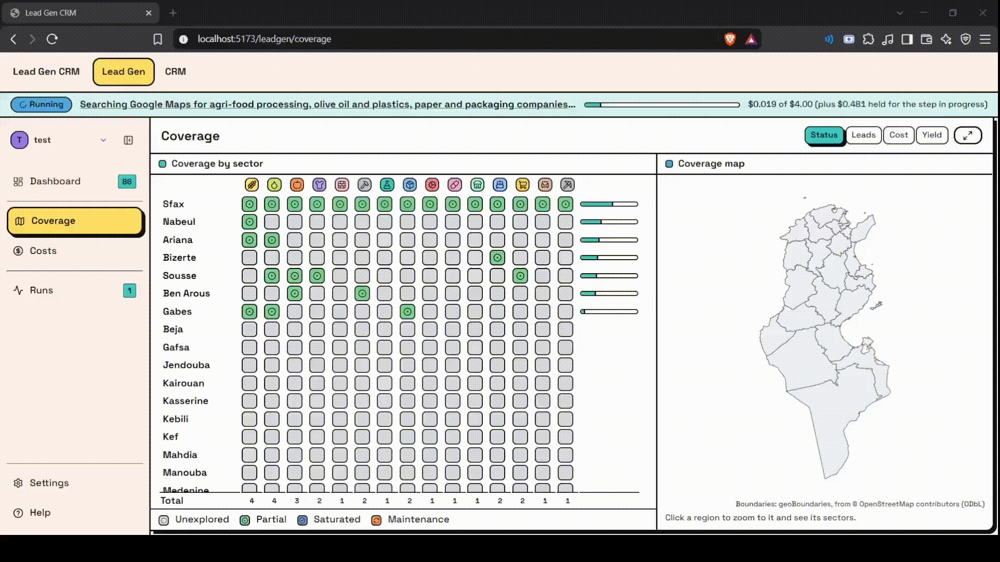
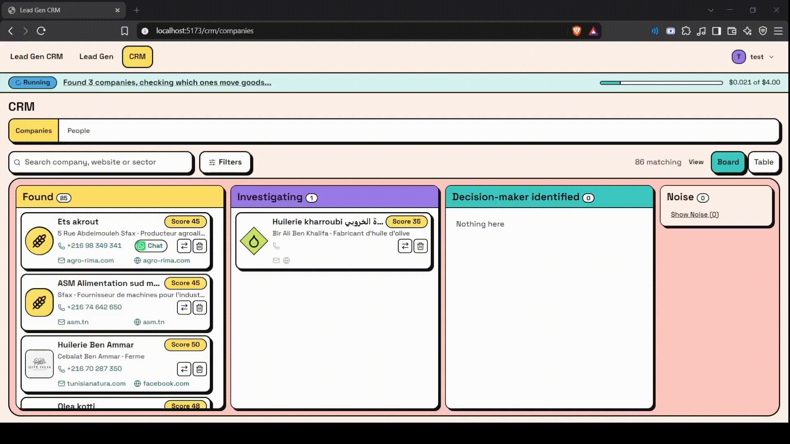

# Lead Gen CRM

**Find the companies that ship goods in a region, and the people who decide how they ship.**

[](https://github.com/Seifpetit/Lead-Gen-CRM/actions/workflows/ci.yml)
[](LICENSE)


A B2B lead generation tool built for Tunisian freight transporters. You pick a region and a spend
cap, and it searches Google Maps for companies in freight-heavy sectors, looks for the named
decision-makers there, and finds a contact channel for each. Everything lands on two drag-and-drop
boards (companies and people), and every stored value shows where it came from.

<!-- GIF 1 (hero): see docs/media/README.md for the shot list.

-->

## What you can do

- **Start a run** for a region with a hard spend cap and a cost estimate before anything is paid.
- **Watch it live** through six plain-language steps, with a technical log when you need it.
- **Work the leads** on two kanban boards: companies, then the people who decide.
- **See coverage** of the map, so each new run goes where it will find the most new companies.
- **Track every cent** in an append-only cost ledger with per-run and monthly caps.

<!-- GIF 2: the Coverage map and matrix.

-->

<!-- GIF 3: the two CRM boards.

-->

## Try it

You need Node 22.13+ and PostgreSQL 16 (Docker is the easiest way to get it).

```sh
npm install
cp .env.example .env            # then set APIFY_TOKEN (and ANTHROPIC_API_KEY for the classifier)
npm run db:up                   # local Postgres on :5432 (skip if you already run one)
npm run db:migrate              # create the schema and load the region outlines
npm run auth:create-user -- you@example.com
npm run dev:backend             # API on http://localhost:3000
npm run dev:frontend            # app on http://localhost:5173
```

Real runs use paid Apify actors and are off by default: set `PAID_RUNS_ENABLED=true` in `.env` when
you are ready, and keep the spend cap low while you test. The full setup, including running
without Docker, is in [Development](docs/DEVELOPMENT.md).

## How it works

A run splits a region into map cells, searches Google Maps in each, scores and classifies the
companies it finds, then looks up decision-makers and their contact details. Providers (Apify) sit
behind small interfaces, and the pipeline stages are pure functions, so each part can be tested
with fixtures and no network.

| Read this                                    | For                                                         |
| -------------------------------------------- | ----------------------------------------------------------- |
| [Development guide](docs/DEVELOPMENT.md)     | Setup, checks, tests, security notes and the ground rules   |
| [Run orchestrator](backend/runner/README.md) | How runs, caps, crash recovery and coverage scheduling work |
| [Providers](backend/providers/README.md)     | The Apify and Google Places adapters and their fixtures     |
| [Pipeline stages](backend/stages/README.md)  | The query grid and each pipeline stage                      |
| [HTTP API](backend/routes/README.md)         | Every route, its auth and its rules                         |
| [Data layer](backend/data/README.md)         | The rules for database access and its commands              |
| [Frontend](frontend/README.md)               | Folder map, UI rules and the browser smoke test             |

## Known limits

- It is an early prototype. One real test run so far found company contacts well but few named
  decision-makers, and improving that is the main open work.
- Tunisia only for now; the region list and job-title dictionary are Tunisian (FR/EN).
- There is no hosted version, billing or multi-team support. It is meant to run on one machine.
- The search sources have their own terms of service, and named people are personal data under
  local law. Check both before contacting anyone.

## License

[MIT](LICENSE). The governorate outlines come from geoBoundaries / OpenStreetMap contributors under
the ODbL; see [Development](docs/DEVELOPMENT.md#data-and-licences).
